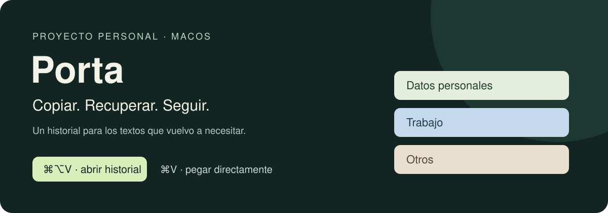

# Porta

**El texto que necesito, sin volver a buscarlo.**

Un proyecto personal para macOS: historial del portapapeles con búsqueda, categorías y un atajo propio que deja intacto el pegado habitual.



[Por qué lo hice](#por-qué-lo-hice) · [En mi día a día](#en-mi-día-a-día) · [Cómo probarlo](#cómo-probarlo) · [Decisiones técnicas](docs/DECISIONS.md)

## Por qué lo hice

Quería poder recuperar algo que había copiado hace un momento, aunque ya hubiera copiado otra cosa después. Una dirección, un texto para un cliente o un fragmento que iba a reutilizar: el portapapeles de un solo elemento se me quedaba corto.

Construí Porta con ayuda de Codex y la fui ajustando a partir de mi propio uso. El primer diseño abría un selector al pulsar **⌘V**. Era cómodo para elegir del historial, pero interfería con una herramienta que utilizo mucho: el dictado de **Wispr**.

Esa fricción cambió el diseño. **⌘V vuelve a pegar directamente y ⌘⌥V abre el historial**. Después llegó otra necesidad: no tener que buscar todos los textos en una misma lista. Añadí categorías locales y una forma de corregirlas a mano.

## En mi día a día

| Situación | Qué aporta Porta |
| --- | --- |
| Copio varias cosas y necesito una anterior | Puedo recuperarla desde el historial sin regresar al documento de origen. |
| Dicto con Wispr | Porta deja libre el pegado habitual para no interrumpir la inserción del dictado. |
| Reutilizo direcciones o identificadores | El filtro **Datos personales** ayuda a encontrarlos. |
| Alterno entre textos de proyectos y clientes | El filtro **Trabajo** reduce la lista que tengo que revisar. |
| Una categoría no encaja | La cambio manualmente; la elección se conserva mientras el elemento siga en el historial. |

El impacto que busco es cotidiano: menos volver atrás, menos repetir búsquedas y menos interrupciones al escribir. **No he medido todavía el ahorro de tiempo**; este proyecto nace de resolver esas pequeñas fricciones en mi propio flujo de trabajo.

## Qué hace hoy

- Vive en la barra de menús de macOS.
- Guarda texto, imágenes y referencias a archivos copiados mientras está abierta.
- Permite buscar, elegir con ↑/↓ y pegar con Enter.
- Filtra por **Todos**, **Datos personales**, **Trabajo** y **Otros**.
- Clasifica texto con reglas locales y permite corregir la categoría o volver a automática.
- Conserva el historial entre sesiones y permite pausarlo o borrarlo.

La clasificación **no usa un modelo de IA**. Detecta patrones de DNI/NIE y direcciones, y términos relacionados con trabajo. Los casos ambiguos quedan en Otros; cuando detecta datos personales en un texto laboral, prioriza Datos personales. No valida documentos de identidad ni entiende todos los contextos.

**[Web de Porta: descarga y guía visual](https://martinzg16.github.io/porta/)**

## Cómo probarlo

### Descargar la aplicación

**[Descargar Porta para Mac — beta 1.3](https://github.com/martinzg16/porta/releases/download/v1.3-beta.2/Porta-1.3-universal-beta.dmg)**

También puedes consultar las [versiones publicadas](https://github.com/martinzg16/porta/releases). Descarga el archivo `.dmg` desde Assets (no «Source code»).

1. Abre el DMG y arrastra **Porta** a **Aplicaciones**.
2. Expulsa el disco y abre Porta desde Aplicaciones.
3. Busca el icono del portapapeles en la barra de menús. Copia algo y pulsa **⌘⌥V**.

Requiere **macOS 14 o posterior**, en **Intel o Apple Silicon**. No necesita Xcode ni Terminal. No funciona en Windows o Linux.

**La beta no está notarizada por Apple.** macOS puede bloquear la primera apertura. Si confías en la descarga del repositorio oficial, tras intentar abrirla utiliza **Ajustes del Sistema → Privacidad y seguridad → Abrir igualmente**, siguiendo la [guía de Apple](https://support.apple.com/es-es/102445). No desactives las protecciones generales del Mac. En equipos gestionados, esta excepción puede estar bloqueada.

[Guía visual de instalación](https://martinzg16.github.io/porta/#instalar).

### Compilar desde el código

Solo para desarrollo: necesitas las herramientas de línea de comandos de Xcode. La compilación genera una app universal (ARM64 e Intel).

```sh
# Si no tienes las herramientas de desarrollo de Apple:
xcode-select --install

git clone https://github.com/martinzg16/porta.git
cd porta
zsh build.sh
open Porta.app
```

1. Copia algo con **⌘C**.
2. En la aplicación de destino, pulsa **⌘⌥V** (Command + Option + V).
3. Busca o filtra, selecciona un elemento y pulsa **Enter**.
4. Para corregir su clasificación, utiliza el selector **Categoría**.

Abrir el historial no requiere Accesibilidad. Sin ese permiso, Enter copia el elemento seleccionado: pulsa Esc y ⌘V para pegarlo. Para pegar automáticamente en otra aplicación, activa **Porta** en **Ajustes del Sistema → Privacidad y seguridad → Accesibilidad**.

| Tecla | Acción |
| --- | --- |
| ⌘V | Pegado normal de la aplicación de destino |
| ⌘⌥V | Abrir el historial de Porta |
| ↑ / ↓ | Elegir un elemento |
| Enter | Pegar la selección |
| Esc | Cerrar el selector |

**El atajo es global mientras Porta está activa y no está pausada.** En Finder sustituye la combinación utilizada para mover archivos copiados. No es configurable todavía.

## Privacidad y límites

Porta funciona localmente: **sin cuenta, sin servidor y sin envío del portapapeles a servicios externos**. El repositorio contiene código y ejemplos sintéticos, nunca mi historial personal.

El historial se guarda en `~/Library/Application Support/Porta/history.json`. **No está cifrado**. Se excluyen contenidos marcados como secretos o transitorios por la aplicación de origen, pero no todas las aplicaciones los identifican: no es un gestor de contraseñas.

- Hasta **100 elementos**, **32 MiB en total** y **12 MiB por copia**.
- Comprueba cambios cada **0,4 segundos**; puede perder copias más rápidas.
- Los archivos se guardan como referencias; deben seguir en su ubicación original.
- Borrar el historial no vacía el portapapeles actual de macOS.
- Las correcciones de categoría se pierden cuando el elemento sale del historial.
- La app no configura inicio automático.

Más detalles en [privacidad y almacenamiento](docs/PRIVACY.md).

## Qué aprendí al construirlo

**Respetar los hábitos importa tanto como añadir funciones.** Reutilizar ⌘V parecía una buena idea hasta probarlo con el dictado.

**Los permisos forman parte de la experiencia.** Separé el registro del atajo del permiso necesario para simular el pegado, de modo que abrir el historial no dependa de Accesibilidad.

**La automatización necesita una salida manual.** Las reglas pueden organizar muchos textos, pero el usuario debe poder corregirlas. Una dirección puede pertenecer a un contexto laboral; el texto por sí solo no siempre lo cuenta.

## Estado del proyecto

Es una herramienta personal en evolución, no una aplicación distribuida y notarizada por Apple. La firma es local; recompilar puede hacer que macOS pida renovar el permiso de Accesibilidad. El pegado puede depender de las restricciones de la aplicación de destino.

Las pruebas automatizadas cubren clasificación, historial antiguo, persistencia de categorías y recuperación de texto, imágenes y referencias a archivos. La compatibilidad con aplicaciones de terceros requiere además uso real; no hay una matriz exhaustiva de compatibilidad.

Posibles siguientes pasos, todavía **no implementados**: categorías propias, atajo configurable y actualizaciones automáticas y distribución firmada y notarizada por Apple.

## Para quien quiera mirar el código

Una app nativa en **Swift + AppKit**, sin dependencias de terceros. [Source/main.swift](Source/main.swift) reúne el modelo, el historial, las reglas de clasificación y la interfaz. El alcance actual cabe en una implementación pequeña y fácil de recorrer.

- [Decisiones y evolución](docs/DECISIONS.md)
- [Compilación, pruebas y estructura](docs/DEVELOPMENT.md)
- [Privacidad y almacenamiento](docs/PRIVACY.md)

Proyecto personal de [@martinzg16](https://github.com/martinzg16), construido de forma iterativa con ayuda de Codex.
